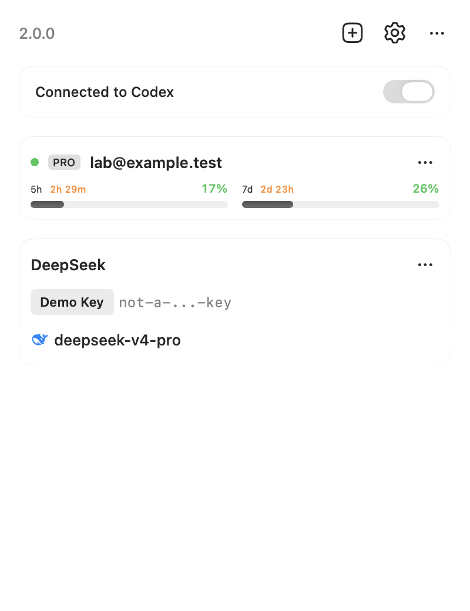
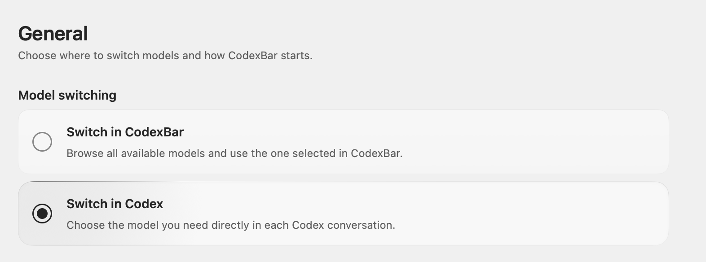

# CodexBar

CodexBar is a macOS menu bar app for Codex Desktop and CLI. Manage OpenAI OAuth accounts, external providers, API keys, and models while keeping session history in one shared `~/.codex`.

[简体中文](./README.md) · [Download v2.0.0](https://github.com/shingex/codexbar/releases/tag/v2.0.0) · [Changelog](./CHANGELOG.md)

Current release: `2.0.0` (Build `347`) for Apple Silicon, macOS 13 or later. Install [Codex](https://github.com/openai/codex) separately.

## Getting Started

1. In Settings → Getting Started, connect an OpenAI account online or import your existing Codex `auth.json`.
2. Optionally add OpenRouter, OpenCode, or another OpenAI-compatible provider. Save models and a default model for each key.
3. In General settings, choose where to switch models. Connect Codex from the menu bar and reload Codex when prompted.

## Where to Switch Models

| Mode | Where you select the model | Use it when |
| --- | --- | --- |
| Switch in Codex | Pick an exported model in each Codex conversation | Conversations need different models at the same time |
| Switch in CodexBar | Pick a target in the menu bar and use the fixed **CodexBar** entry in Codex | Conversations should follow the same current target |

New configurations default to switching in Codex; older configurations without the setting continue to follow CodexBar. The exported catalog includes models saved for each key. Reload Codex when prompted after changing the catalog. Official models continue to use OpenAI OAuth; disconnecting restores direct OAuth access. Aggregate account mode is no longer available.

## Screenshots

These are native 2.0.0 views with fictional accounts, keys, and quota data.

## Day-to-Day Management

- **Usage and quota:** Opening the panel refreshes eligible upstream quota data. Configure background polling independently. Local sessions are no longer used to estimate tokens or costs.
- **Session history:** Search and filter all, active, or archived sessions, inspect messages, copy `codex resume <sessionID>`, or delete local sessions. Archive status is read-only.
- **Skills and backups:** Manage local Skills and back up CodexBar settings separately from Codex authentication and configuration. Backups can contain credentials.
- **Local automation:** Use [`codexbarctl`](./scripts/codexbarctl) to query the running app and manage targets. See the [repository Skill](./.codex/skills/codexbar/SKILL.md). In catalog mode, select models in Codex.
- **Gateways:** Local Codex connects to `127.0.0.1:1456`; OpenRouter uses port `1457`. The listeners can be reached over the LAN. Do not expose them to the public internet.

## Build Locally

Open `codexbar.xcodeproj` in Xcode and select the `codexbar` scheme and your Mac's architecture. The test target is `codexbarTests`. See the [model catalog](./docs/codex-model-catalog.md) and [tool history compatibility](./docs/tool-history-compatibility.md) notes for implementation details.

## Credits and License

Inspired by [lizhelang/codexbar](https://github.com/lizhelang/codexbar), [xmasdong/codexbar](https://github.com/xmasdong/codexbar), [steipete/CodexBar](https://github.com/steipete/CodexBar), and [farion1231/cc-switch](https://github.com/farion1231/cc-switch). See the [third-party notices](./THIRD_PARTY_NOTICES.md) and [MIT license](./LICENSE).
