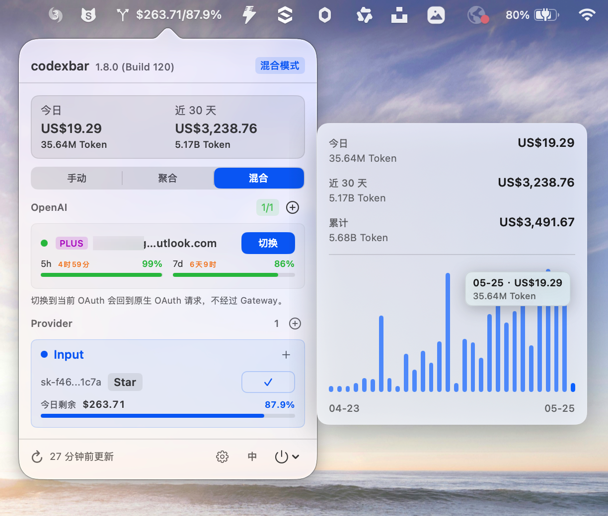
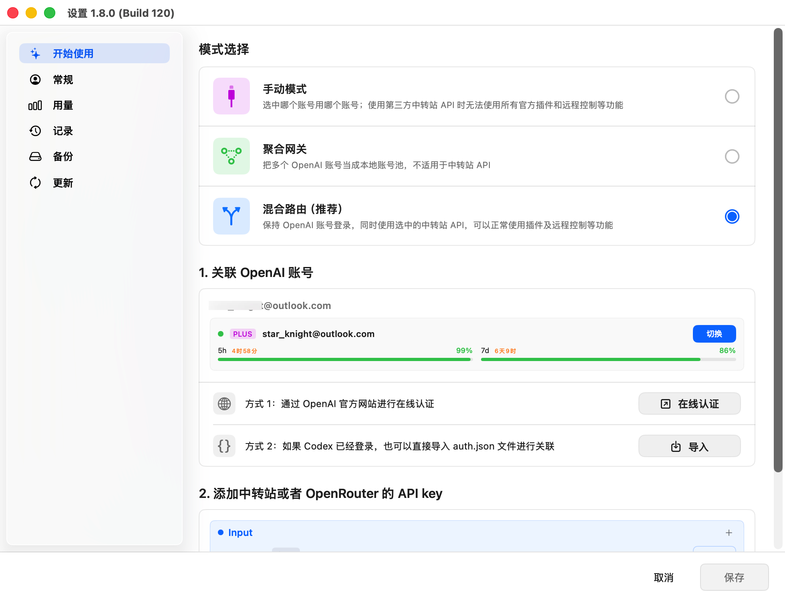
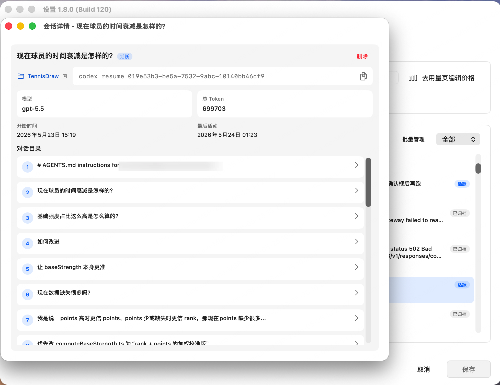
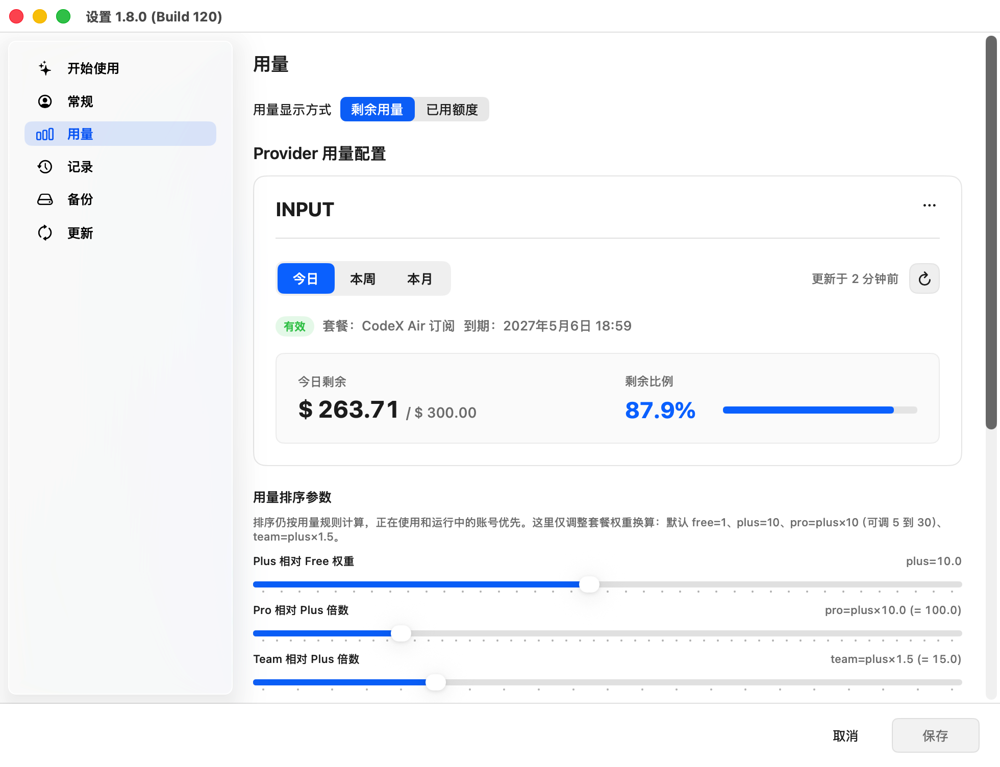
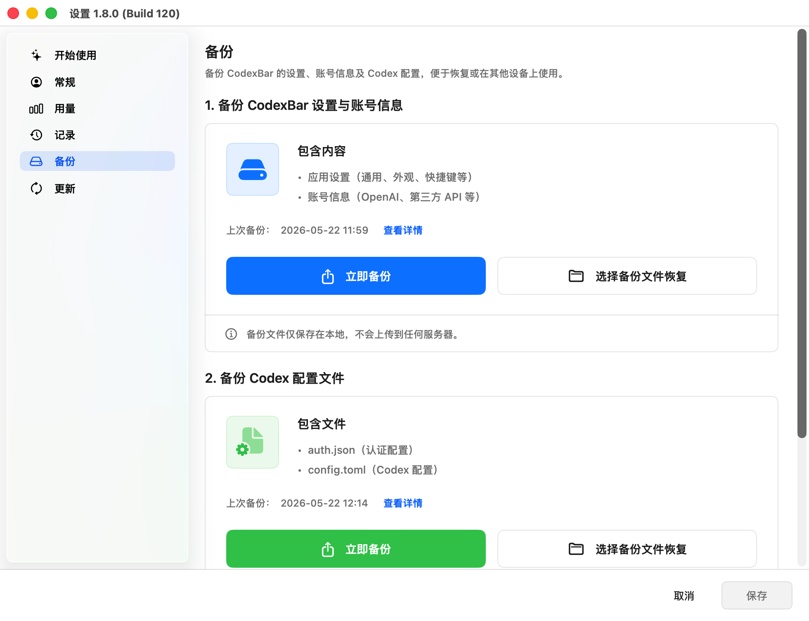
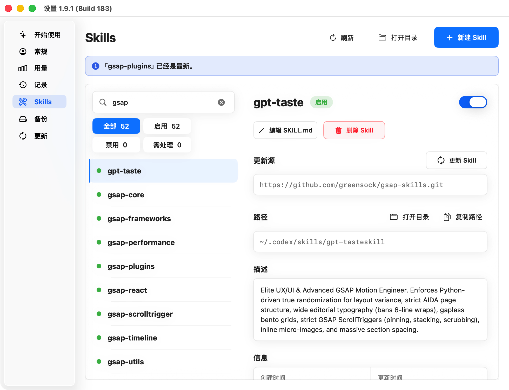

# codexbar

CodexBar 是面向 Codex Desktop / Codex CLI 用户的 macOS 菜单栏控制台，用来统一管理 OpenAI 多账号、OpenRouter、第三方 OpenAI 兼容中转站、跨账号历史记录、用量统计、Skills 和增强型本地网关。

如果你正在找 Codex 账号切换器、Codex OpenRouter 工具、Codex 中转站网关、Codex 用量统计、Codex 历史记录管理器、Codex Skills 管理器，或者 CCSwitch / cc-switch alternative，CodexBar 解决的是同一类问题，但把账号、模型、网关、历史、用量和 Skills 放进同一个本地可视化界面。

它适合已经在使用 Codex Desktop / Codex CLI 的用户，尤其是同时维护多个 OpenAI OAuth 账号、多个 API Key、OpenRouter 模型、第三方中转站，或者需要在 Mac 与移动端之间共享同一套 Codex 路由的人。

当前版本：`1.9.9`（Build `265`）。

[English](./README.en.md)

## 下载

从 GitHub Releases 下载最新版：

- [下载 codexbar](https://github.com/shingex/codexbar/releases)
- 运行环境：macOS 13+
- 需要已安装并使用 [Codex Desktop / CLI](https://github.com/openai/codex)

`codexbar` 不内置任何私有 provider、API Key 或账号配置。所有账号、Key 和 provider 都只在你的本机配置。

## 你可以用它做什么

- **更直观地切换 Codex 账号和中转站**：在菜单栏里切换 OpenAI OAuth 账号、OpenRouter Key、第三方 OpenAI-compatible provider 和模型，不需要反复手改 `~/.codex/config.toml`。
- **保留一个跨账号历史池**：不再为每个账号拆一套 `CODEX_HOME`；`resume`、活跃会话、归档会话和 token 统计都继续留在同一个 `~/.codex`。
- **管理中转站模型接口**：OpenRouter 和自定义 OpenAI 兼容 provider 可以作为 Codex 的请求目标，同时启用 CodexBar 接入以保留 Codex 插件、MCP、远程访问等依赖 OpenAI 登录态的能力。
- **看清用量、额度和重置机会**：汇总本地 Codex token / usage / 成本估算，查看第三方 provider 额度，并支持查询官方重置次数。
- **管理 Codex 会话记录**：浏览跨账号会话，复制 `codex resume <sessionID>`，查看 token、模型和对话目录，并支持删除不需要的会话记录。
- **管理和更新本机 Skills**：搜索、启用 / 禁用、查看来源、检查更新、创建和删除 `~/.codex/skills` 下的 Skill。
- **在局域网共享同一套路由**：本地 gateway 可监听局域网地址，手机或其他设备可以通过 Mac 的局域网 IP 使用同一套 Codex 路由。
- **本地备份与恢复**：分别备份 CodexBar 设置 / 账号信息，以及 Codex 的 `auth.json`、`config.toml`，便于迁移、恢复或在其他设备上复用。
- **Sub2API 账号互通**：支持 OpenAI 账号 CSV 导入 / 导出，方便批量迁移和整理账号。

## 和普通切换器的区别

很多 Codex 切换器只解决“当前用哪个账号或 base URL”。CodexBar 更像一个 Codex 本地控制台：

| 问题 | 普通脚本 / 轻量切换器 | CodexBar |
|------|----------------------|----------|
| 多账号切换 | 主要改配置 | 菜单栏可视化切换账号、Provider、OpenRouter Key 和模型 |
| 历史记录 | 常被多个 `CODEX_HOME` 拆散 | 一个共享 `~/.codex`，跨账号统一浏览、resume、归档和删除 |
| 中转站 | 通常只改 `openai_base_url` | 支持 CodexBar 接入，保留插件、MCP、远程访问和账号态能力 |
| 用量可见性 | 依赖外部账单或手工统计 | 本地 usage / token / 成本估算、provider 额度、官方重置次数查询 |
| Skills | 通常不覆盖 | 管理、启用、禁用、更新、创建和删除本机 Skills |

## 为什么需要 codexbar

Codex 的账号和 provider 配置最终会落到 `~/.codex/config.toml` 与 `~/.codex/auth.json`。如果手动切换账号、中转站或 OpenRouter，很容易遇到几个问题：

- 多账号切换后，会话历史被不同目录拆散
- 直接改 `openai_base_url` 后，插件、MCP 或依赖 OpenAI 登录态的功能不稳定
- OpenRouter Key 和模型越来越多，主配置变得难维护
- 本地会话记录、归档记录和删除操作缺少统一界面
- Skills 分散在 `~/.codex/skills` 下，来源、启用状态和更新状态不直观
- 桌面端、移动端、远程设备无法方便复用同一套路由
- 本地 token 用量、provider 额度、官方重置次数和备份状态缺少统一视图

`codexbar` 的做法是：保留一个共享的 `~/.codex`，用菜单栏管理账号、provider、模型、gateway、历史记录和 Skills，再按当前模式把最小必要配置同步给 Codex。

## 截图

### 菜单栏主面板

主面板集中展示当前模式、OAuth 账号、模型、本地用量估算、provider 额度进度，以及 Provider / OpenRouter 的快速切换入口。

<p align="center">
  
</p>

### 开始使用

开始使用界面提供模式选择、OpenAI 账号关联和第三方 API key 添加入口，帮助你更快完成基础设置。

<p align="center">
  
</p>

### 设置与会话记录

设置窗口提供账号、记录、用量、备份和更新入口；记录页可以浏览跨账号 Codex 会话、复制 `codex resume` 命令、查看单个会话的 token、模型和对话目录，并删除不再需要的本地会话记录。

<p align="center">
  
</p>

### 用量页面

用量页面可以在剩余额度和已用额度之间切换，按今天、本周、本月查看 provider 额度，并通过权重参数调整不同套餐账号的排序优先级。OpenAI 官方账号还可以查询本地缓存的重置机会。

<p align="center">
  
</p>

### 本地备份

备份页面把 CodexBar 设置 / 账号信息和 Codex 配置文件拆成两个独立备份项。备份文件只保存在本机，不会上传到任何服务器。

<p align="center">
  
</p>

### Skills 页面

Skills 页面用于管理本机 `~/.codex/skills`，可以按名称、描述或路径搜索，查看每个 Skill 的描述、更新源和文件信息，并进行启用 / 禁用、更新、创建和删除操作。

<p align="center">
  
</p>

## 在 Codex 中使用 CodexBar

主面板的「在 Codex 中使用 CodexBar」是唯一接入开关，不再分别选择手动或混合模式。

- 关闭：使用当前登录的 OpenAI OAuth 账号纯净直连。
- 开启：恢复上次使用的账号或 Key / Model。在 Codex 的模型列表选择 **CodexBar**，即可使用当前选中的目标。
- 关闭时仍可查看和管理模型；点击第三方目标会自动开启接入。
- 开启、关闭后按提示重新加载 Codex；已开启时更换目标无需重启，进行中的请求保持原目标。
- 设置页的目标选择仍先进入草稿，点击【保存】才生效。关闭接入保留已保存的 Key / Model 编辑。

选择官方模型时，保留入站 OAuth 凭据、模型和请求内容，透传至 OpenAI；仅固定 `codexbar` 入口路由到所选目标。官方链路使用系统代理，保留 300 秒请求等待及长输出预算。

### 容量错误重试

官方模型和 CodexBar 入口仅针对错误响应中的 `Selected model is at capacity. Please try a different model.` 自动重试。每个入站请求总共最多 5 次上游请求，等待基准依次为 5、10、20、30 秒，附加 0–20% 抖动。遵守更长的合法 `Retry-After`；超过 120 秒则返回错误。

重试保持原账号、模型、凭据和内容，不自动换目标。已输出正文、推理或工具调用后不重放；停止生成会取消请求和等待。其他 429、5xx、网络错误不因此加入重试。容量错误耗尽后返回最后错误并结束连接。

旧混合路由配置会迁移为接入开启并保留目标；聚合模式已移除。

桌面端同步到 Codex 时使用本机稳定地址：

- OpenAI gateway：`127.0.0.1:1456`
- OpenRouter gateway：`127.0.0.1:1457`

移动端或其他局域网设备访问时，使用 Mac 的局域网 IP 加对应端口。

## 共享会话历史

`codexbar` 默认只维护一个 `~/.codex`：

- `~/.codex/sessions`
- `~/.codex/archived_sessions`
- `~/.codex/config.toml`
- `~/.codex/auth.json`

切换账号或 provider 只影响之后发起的新请求和新会话，不会把既有 session 拆到多个目录里。

记录页会在这个共享历史池上工作：

- 按全部 / 活跃 / 已归档筛选本机 Codex 会话
- 搜索标题、目录、session ID 或模型
- 复制 `codex resume <sessionID>` 命令
- 查看单个会话的 token、模型、目录和消息
- 删除不再需要的本地会话记录

## Provider / Key / Model

兼容 Provider、第三方预设、OpenCode 和 OpenRouter 均在每个 Key 下保存模型列表和当前请求模型。Provider 保存请求地址等公共配置，显示名称可选；未填写时显示预设名称或地址主机名。OAuth 账号保持独立结构。

新增或编辑 Key 时必须指定请求地址、凭据和当前请求模型；可以从目录选择或填写自定义 ID，无需在线验证。新 Key 不继承其他 Key 或 Provider 的模型。旧 Key 缺模型时保留原样，编辑该 Key 才需补齐；仅编辑 Provider 公共信息不要求修复其下 Key。完整目录保存于独立缓存。

## OpenRouter 管理

OpenRouter 支持多 Key、多模型和独立选择状态：

- 每个 OpenRouter API Key 可以独立保存当前模型和固定模型列表
- 新增 Key 不会继承其他 Key 的当前模型状态
- 编辑 Key 时可以修改 API Key、标签和模型勾选
- 菜单栏主面板可直接展开已勾选模型，作为手动切换入口
- 大体量模型目录不会写入主配置，避免污染 `~/.codexbar/config.json`

这适合同时维护多个 OpenRouter Key、多个模型入口，或者需要按 Key 分离用途的 Codex 用户。

## 中转站与远程访问

使用自定义 OpenAI 兼容 provider 时，可以选择：

- 直接把请求转到 provider
- 启用接入以保留 OpenAI OAuth 登录态，并通过 CodexBar 模型入口选择 provider
- 通过局域网 gateway 让移动端或远程设备访问 Mac 上的同一套路由

当前 gateway 端口：

- OpenAI gateway：`0.0.0.0:1456`
- OpenRouter gateway：`0.0.0.0:1457`

Codex 本机配置仍写入 `127.0.0.1`，移动端访问时改用 Mac 的局域网 IP。

## 本地用量与成本估算

`codexbar` 会扫描本地 session 文件，展示 token、usage 和成本估算。

统计来源：

- `~/.codex/sessions`
- `~/.codex/archived_sessions`

token 口径：

- `input + cached_input + output`

注意：

- 这是本地 usage estimate，不是 OpenAI 官方账单
- 不会额外拉取或聚合远端 usage
- 未配置价格的模型按 `0` 成本处理，但 token 仍会统计
- 自定义 provider 的估算金额可能与供应商真实扣费不同

## Provider 额度管理

用量页会读取 provider 的额度信息，并在菜单栏和设置窗口中展示剩余额度或已用额度。OpenAI OAuth 账号还支持查询官方重置机会，并把结果缓存在本机。

可查看范围：

- 今天
- 本周
- 本月

可调整的排序参数：

- Plus 相对 Free 权重
- Pro 相对 Plus 倍数
- Team 相对 Plus 倍数

这些参数只影响 CodexBar 在多账号、多套餐场景下的本地排序判断，不会修改 provider 侧的真实套餐或账单。

## Skills 管理

CodexBar 会读取本机 `~/.codex/skills`，把 Skill 维护放进设置窗口：

- 搜索 Skill 名称、描述或路径
- 查看 `SKILL.md` 元数据、来源仓库和文件信息
- 启用或禁用单个 Skill
- 检查 GitHub 来源更新并生成更新命令
- 创建新的 Skill
- 删除不再需要的 Skill

安装或转换 Skill 时，如果 `SKILL.md` 前 80 行包含 `source:`、`repository:`、`repo:`、`canonical:` 或 `Converted from:` 后的 GitHub 仓库地址，CodexBar 会用它识别更新来源。

## 增强型 Gateway

CodexBar 的本地 gateway 提供以下路由能力：

- **按模型分流**：官方模型透明转发，`codexbar` 复用混合路由当前选择的账号或 Key / Model。
- **模型路由**：保留 OpenAI OAuth 登录态，固定 CodexBar 入口使用选定的账号或 Key / Model。

## 本地备份与恢复

备份页提供两类本地备份：

- CodexBar 设置与账号信息：包含应用设置、外观、快捷键、OpenAI / 第三方 API 账号信息等
- Codex 配置文件：包含 `auth.json` 和 `config.toml`

备份文件只保存在本机。恢复时可以选择对应备份文件导入，适合迁移到新 Mac、恢复误改配置，或在多台设备之间同步同一套 CodexBar / Codex 配置。

## OpenAI 登录

OpenAI 登录采用浏览器授权加 localhost 回调捕获，必要时支持手动粘贴回调。

操作流程：

1. 点击菜单底部工具栏的人像加号按钮
2. 在浏览器完成 OpenAI 授权
3. 浏览器跳转到 `http://localhost:1455/auth/callback?...`
4. `codexbar` 自动捕获回调并导入账号

如果自动捕获失败，可以把完整回调 URL 或单独的 `code` 粘贴回登录窗口。

## 更新

`codexbar` 会检查 GitHub Releases 中可安装的稳定版本：

- 启动时非阻塞检查更新
- 菜单栏支持手动“检查更新”
- 跳过 `draft`、`prerelease` 和不带 `dmg` / `zip` 安装包的 release
- 当前更新方式是引导下载 / 安装，不会自动替换旧 app 或自动重启

详细更新策略见：

- [docs/update-feed-rollout.md](./docs/update-feed-rollout.md)

## 本地构建

```sh
git clone https://github.com/shingex/codexbar.git
cd codexbar
open codexbar.xcodeproj
```

然后：

1. 在 Xcode 里选择自己的签名团队
2. 构建并运行 `codexbar` target

如果只是使用，不需要本地构建，直接从 [GitHub Releases](https://github.com/shingex/codexbar/releases) 下载即可。

## 适合谁

`codexbar` 适合这些 Codex 用户：

- 同时使用多个 OpenAI OAuth 账号
- 想合并 Codex 多账号会话记录，而不是拆多个 `CODEX_HOME`
- 使用 OpenRouter、第三方 OpenAI API 中转站或自建 OpenAI 兼容服务
- 希望中转站场景下尽量保留 Codex 插件、MCP 和账号态能力
- 想管理、更新或清理本机 `~/.codex/skills`
- 需要在 Mac、手机、远程设备之间共享同一套 Codex 路由
- 想在本地查看 Codex token 用量、成本估算、provider 额度和官方重置机会

## Star 历史

<p align="center">
  <a href="https://star-history.com/#shingex/codexbar&Date">
    <picture>
      <source
        media="(prefers-color-scheme: dark)"
        srcset="https://api.star-history.com/svg?repos=shingex/codexbar&type=Date&theme=dark"
      />
      <source
        media="(prefers-color-scheme: light)"
        srcset="https://api.star-history.com/svg?repos=shingex/codexbar&type=Date"
      />
      
    </picture>
  </a>
</p>

## 致谢

这个项目基于原始 `codexbar` 方向继续演进，并参考、改造了下面 MIT 许可证项目中的思路与部分实现：

- [lizhelang/codexbar](https://github.com/lizhelang/codexbar)
- [xmasdong/codexbar](https://github.com/xmasdong/codexbar)
- [steipete/CodexBar](https://github.com/steipete/CodexBar)
- [farion1231/cc-switch](https://github.com/farion1231/cc-switch)

详细说明见：

- [THIRD_PARTY_NOTICES.md](./THIRD_PARTY_NOTICES.md)

## License

[MIT](./LICENSE)

### Agent 命令行接口

CodexBar 运行时，Codex、OpenCode 或其他本机 Agent 可以使用 `codexbarctl` 查询和切换配置。CLI 通过仅当前用户可访问的本地 socket 调用应用，不直接修改 Codex 配置。安装 CLI 和可选的仓库 Skill：

```sh
mkdir -p ~/.local/bin ~/.codex/skills
cp scripts/codexbarctl ~/.local/bin/codexbarctl
# 可选：确认目标不存在或自行备份后安装 Skill
cp -R .codex/skills/codexbar ~/.codex/skills/
```

确保 `~/.local/bin` 在 `PATH` 中。使用 `codexbarctl --help` 查看所有命令，例如：

```sh
codexbarctl status
codexbarctl mode hybrid_provider
codexbarctl activate --provider-id PROVIDER_ID --account-id ACCOUNT_ID
codexbarctl model --provider-id PROVIDER_ID --account-id ACCOUNT_ID --model-id MODEL_ID
```

添加 Provider 时使用 `codexbarctl provider-add --label NAME --base-url URL --api-key-stdin`，通过标准输入提供 API Key；编辑密钥时使用 `provider-edit --api-key-stdin`。不要将密钥放入命令参数或 shell 历史。输出为 JSON，操作失败返回非零退出码。修改模式或激活目标会影响后续 Codex 请求。
