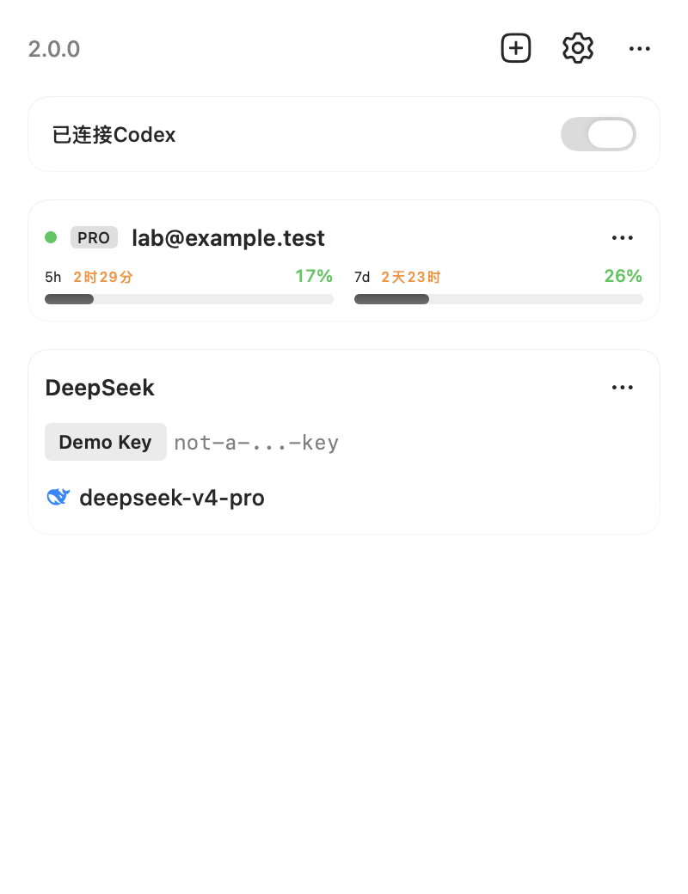
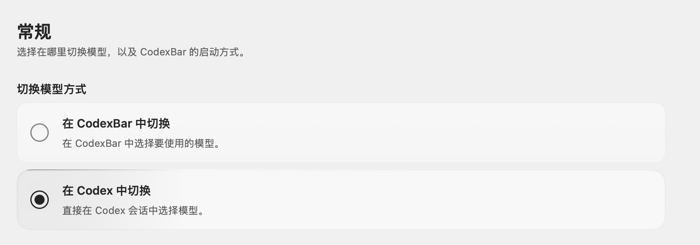

# CodexBar

CodexBar 是用于 Codex Desktop 和 CLI 的 macOS 菜单栏应用。在一个共享的 `~/.codex` 下管理 OpenAI OAuth 账号、第三方 Provider、API Key 和模型，不必为切换账号拆分历史记录。

[English](./README.en.md) · [下载 v2.0.1](https://github.com/shingex/codexbar/releases/tag/v2.0.1) · [更新日志](./CHANGELOG.md)

当前发布版本：`2.0.1`（Build `354`），支持 Apple Silicon，系统要求 macOS 13+。需要另外安装 [Codex](https://github.com/openai/codex)。

## 开始使用

1. 打开 CodexBar，在「设置 → 开始使用」关联 OpenAI 账号。可在线认证，也可导入 Codex 已有的 `auth.json`。
2. 按需添加 OpenRouter、OpenCode 或其他 OpenAI 兼容 Provider，为每个 Key 保存可用模型和默认模型。
3. 在「设置 → 常规」选择切换模型的方式，然后打开菜单栏的「连接 Codex」。按提示重新加载 Codex，使接入配置生效。

## 两种模型切换方式

| 方式 | 在哪里选模型 | 适合 |
| --- | --- | --- |
| 在 Codex 中切换 | 在每个 Codex 会话的模型列表里选择导出的模型 | 不同会话并行使用不同模型 |
| 在 CodexBar 中切换 | 在菜单栏选定目标，在 Codex 选择固定的 **CodexBar** 入口 | 多个会话跟随同一个当前目标 |

新配置默认在 Codex 中切换；缺少该设置的旧配置继续跟随 CodexBar。导出目录只包含各 Key 已保存的模型；增删导出模型后按提示重新加载 Codex。官方模型继续使用 OpenAI OAuth；关闭接入后回到 OAuth 直连。2.0.0 不再提供聚合账号模式。

## 界面截图

以下为 2.0.0 原生界面，账号、Key 和额度均为模拟数据。

## 日常管理

- **用量和额度**：打开面板时按需刷新 OpenAI 与已配置 Provider 的上游额度。可调整后台查询周期；不再从本地会话估算 token 或成本。
- **会话记录**：搜索与筛选全部、活跃或已归档会话，查看消息，复制 `codex resume <sessionID>` 或删除本地会话。归档状态只读。
- **Skills 和备份**：查看及管理本机 Skills；分别备份 CodexBar 配置与 Codex 认证/配置文件。备份可能含凭据，请妥善保存。
- **本机自动化**：运行中的应用可通过 [`codexbarctl`](./scripts/codexbarctl) 查询状态和管理目标，详见[仓库 Skill](./.codex/skills/codexbar/SKILL.md)。导出模式下请在 Codex 内选模型。
- **网关**：本机 Codex 连接 `127.0.0.1:1456`；OpenRouter 网关使用 `1457`。监听可被局域网访问，请勿向公网暴露这些端口。

## 本地构建

在 Xcode 打开 `codexbar.xcodeproj`，选择 `codexbar` scheme 和本机架构。测试目标为 `codexbarTests`。路由与兼容细节见[模型目录](./docs/codex-model-catalog.md)和[工具历史兼容](./docs/tool-history-compatibility.md)。

## 致谢与许可

参考 [lizhelang/codexbar](https://github.com/lizhelang/codexbar)、[xmasdong/codexbar](https://github.com/xmasdong/codexbar)、[steipete/CodexBar](https://github.com/steipete/CodexBar) 和 [farion1231/cc-switch](https://github.com/farion1231/cc-switch)。详见 [第三方声明](./THIRD_PARTY_NOTICES.md)与 [MIT 许可证](./LICENSE)。
